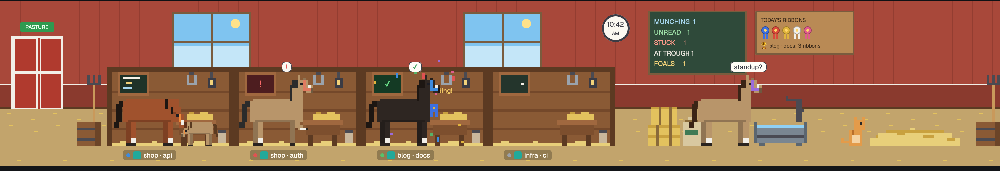

# Stable for Herdr

Stable is a [Herdr](https://herdr.dev) layout that shows each of your coding agents as a horse in a barn, in a strip above your terminals. It is a reskin of [Office for Herdr](https://github.com/DustyPolk/herdr-office) by DustyPolk, with horses drawn over DustyPolk's office.



## Credit to Office for Herdr

Office for Herdr, by [DustyPolk](https://github.com/DustyPolk), is the original layout, and almost all of the code and design in this repo comes from it. DustyPolk designed and built the scene, and the stable runs on DustyPolk's code. The office scene includes the following parts:

- The way the scene tracks each agent's state and moves characters between their desk, the water cooler and the couch.
- The walking and other animations, the arrivals and departures, the interns, the remote video call, the pizza party and the cat.
- The wall clock, the weather and seasonal decorations, the night lighting, and the hover and click behavior.

The stable changes the art and the theme on top of the office, with these differences:

- The people are horses, the office is a barn, and the pizza party is an apple delivery.
- The stable adds the horse sounds and the ribbon wall, and it makes night mode optional.
- The stable removes the "days since last incident" sign and the "employee of the month" portrait.

If you like the stable, please star and use [the original](https://github.com/DustyPolk/herdr-office), which you can also install by asking the agent in your Herdr window to "Add the layout herdr.dev/layouts/DustyPolk/herdr-office".

## What the horses do

Each agent gets its own stall, a coat color that stays the same for its terminal, and a nameplate with its space and tab. Click a horse or its stall to go to that agent's terminal, or hover over a horse to see its terminal title. When a horse leaves its stall for the trough or the straw, it shows a small copy of its nameplate under its hooves, so you can tell which agent it is.

| Agent state | What the horse does |
|---|---|
| Working | Eats at its manger, and its stall chalkboard fills with lines |
| Idle | Walks to the water trough and chats in speech bubbles |
| Idle for 10 minutes | Lies down in the straw with "zZz" |
| Blocked | Paws the ground in its stall with a red "!" |
| Blocked for 5 minutes | Rears up and yells "NEIGH!!", and the barn flashes red |
| Done and not yet seen | Hops with a blue ribbon and confetti until you look at its terminal |

Sub-agents show up as foals beside their parent's manger, and agents on another machine appear on a pasture video call on the wall. When 3 agents finish within 5 minutes, a pony brings a bucket of apples, and the idle horses gather around it for 8 minutes.

The board next to the chalkboard collects a ribbon each time an agent finishes, and it starts empty each day. Hover over a ribbon to see who earned it and when. The barn cat naps on empty mangers.

## Sounds

| Event | Sound | Played by |
|---|---|---|
| An agent finishes | A quiet snort (`snort.mp3`) | Herdr's "done" alert |
| An agent is blocked | Hoof stamps (`stamp.mp3`) | Herdr's "blocked" alert |
| A horse rears | A stallion whinny (`neigh.mp3`) | The stable |
| A horse arrives or leaves | A clip-clop (`trot.mp3`) | The stable |
| The apples arrive | Chewing (`crunch.mp3`) | The stable |

Herdr plays its "done" and "blocked" alerts only when you aren't looking at that agent, and the alert files apply in every layout. The stable plays its own sounds one at a time, and it plays nothing when it reloads. The sources and licenses are in `mods/stable/sounds/CREDITS.md`.

## Install

1. Copy `layouts/stable.json` and `layouts/stable.svg` into `~/.config/herdr-app/layouts/`.
2. Copy `mods/stable/` into `~/.config/herdr-app/mods/`.
3. Merge `keys.json` into `~/.config/herdr-app/keys.json`. It adds `ctrl-shift-i` to hide or show the barn strip while the stable layout is on screen.
4. To use the horse sounds for Herdr's alerts, add these lines to the `sounds` section of `~/.config/herdr-app/settings.json`:
   ```json
   "done": "mods/stable/sounds/snort.mp3",
   "blocked": "mods/stable/sounds/stamp.mp3"
   ```
5. Run `herdr-app check ~/.config/herdr-app/mods/stable`.
6. Run `herdr-app do layout.switch --name stable`.

To go back to another layout, press `ctrl-shift-l` or run `herdr-app do layout.switch --name <name>`.

## Settings

Night mode dims the barn from 8 PM to 6 AM, and it is off by default. To turn it on, set `"night": true` in the `props` of the block with `"mod": "stable"` in `layouts/stable.json`. The change takes effect the next time the stable reloads, e.g., when you switch layouts.

The windows can show your real weather, and the setting is off by default because it sends your IP address to `ipapi.co` for a rough location. To turn it on, set `const WEATHER = true;` near the top of `mods/stable/main.js`.

## Known limits

- The stable counts finishes for the ribbon wall and the apples only while it is the layout on screen.
- With 5 or more horses in a normal-width window, the trough and straw pile run off the right edge of the strip.
- The stable keeps the count of recent finishes that starts an apple party in memory, so a reload resets it. The party itself survives reloads.

## Ideas

Ideas for future changes are in `IDEAS.md`.

## License

MIT, the same as Office for Herdr. `LICENSE` keeps DustyPolk's original copyright notice, which the MIT license requires in every copy.
